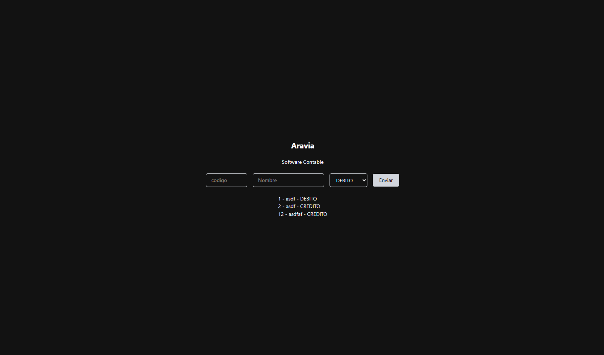

# Aravia · Software Contable

Registro de cuentas contables con un código jerárquico. API en NestJS y frontend en React.

## Qué se puede hacer

- Crear cuentas con código, nombre y naturaleza (DEBITO o CREDITO) desde el formulario.
- Ver el listado de cuentas creadas.
- Validaciones al crear (la API responde con el motivo y el front lo muestra bajo el formulario):
  - El código es un entero de 1 a 6 dígitos (1 a 999999).
  - El código no se puede repetir (409).
  - La cuenta debe tener padre, deducido del propio código (400 si no existe).

### Jerarquía de códigos

El código define el árbol. Los niveles son de 1, 2, 4 y 6 dígitos y el padre es el prefijo del nivel superior:

1            raíz
└─ 11        hijo de 1
   └─ 1105   hijo de 11
      └─ 110505   hijo de 1105

Por eso las cuentas se crean de arriba hacia abajo: para registrar 1105 ya tiene que existir 11. Los códigos de 3 o 5 dígitos se rechazan porque no tienen padre posible.

## Cómo correrlo

Requisitos: Node 22 (.nvmrc) y npm 10 o superior.

bash
npm install     # instala la raíz, api/ y web/
npm run dev     # levanta los dos a la vez

Abre http://localhost:5173.

| Script | Qué hace |
|--------|----------|
| npm run dev | API (3000) y front (5173) juntos, en modo watch |
| npm run dev:api / npm run dev:web | Solo uno de los dos |
| npm run build | Compila los dos |
| npm test | Pruebas de la API con Vitest |
| npm run lint | Revisa los dos con oxlint |

## API

| Método | Ruta | Descripción |
|--------|------|-------------|
| POST | /cuenta | Crea una cuenta |
| GET | /cuenta | Lista las cuentas |
| PATCH | /cuenta/:id | Actualiza una cuenta (revalida código y padre si cambia el código) |
| DELETE | /cuenta/:id | Elimina una cuenta |

Ejemplo:

json
POST /cuenta
{ "codigo": 1105, "nombre": "Caja general", "naturaleza": "DEBITO" }

## Configuración

- El front lee la URL de la API de VITE_API_URL (por defecto http://localhost:3000). Ver [web/.env.example](./web/.env.example).
- La API acepta peticiones del origen WEB_ORIGIN (por defecto http://localhost:5173).

## Decisiones y límites

- Persistencia en memoria. Las cuentas viven en el service y se pierden al reiniciar la API. Con una base de datos, el id lo asignaría el motor.
- codigo es numérico. Alcanza porque el primer dígito nunca es 0, pero no admitiría códigos con ceros a la izquierda.
- Fuera de alcance por ahora: impedir borrar o recodificar una cuenta que ya tiene hijas, y mostrar las cuentas como árbol en el front (existe flatToTree en api/src/cuenta/utils/, pero aún no está conectado).

(se me fue el internet a 12 minutos de que la prueba finalizara 😿)
